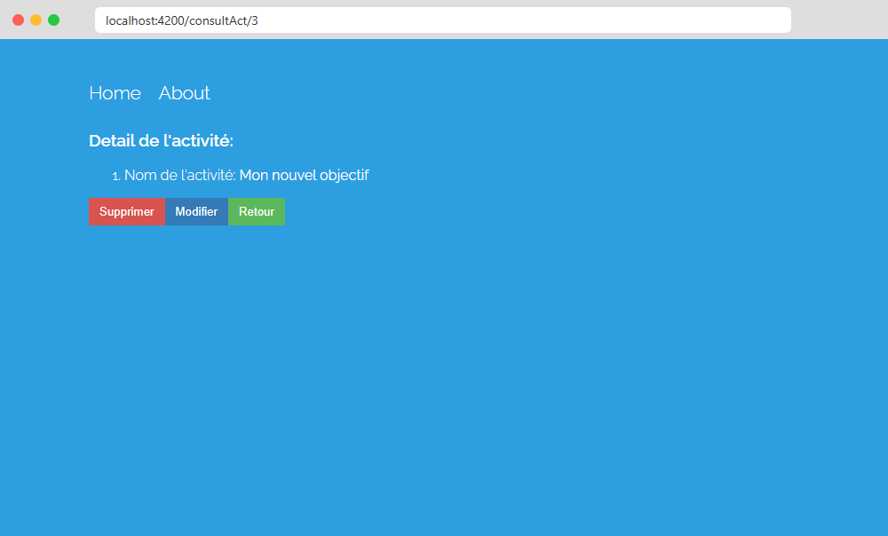

# TP5 Angular – Services et déploiement

M2 CIM – Module Champ d'Application (Angular)

## Partie I : Services

### 1.1 / 1.2 – Création et injection du service

J'ai généré le service avec `ng generate service services/activite`. Il a bien `providedIn: 'root'`, donc pas besoin de l'ajouter dans un tableau `providers`.

Ensuite je l'ai injecté dans le constructeur de `HomeComponent` :

```ts
constructor(public activiteService: ActiviteService, private router: Router) { }
```

Je l'ai mis en `public` pour pouvoir l'utiliser directement dans le template.

### 1.3 – Déplacement du tableau `objectifs`

Le tableau est maintenant dans le service (`services/activite.service.ts`) :

```ts
objectifs = ['Un element', 'deux elements', 'trois elements!'];
```

Dans le HTML j'utilise `activiteService.objectifs` au lieu de `objectifs`. L'animation marche toujours, elle se base sur `activiteService.objectifs.length`.


### 1.4 – Vérification après navigation

J'ai ajouté deux éléments, je suis allé sur About puis je suis revenu sur Home : les éléments sont toujours là. Comme le service est un singleton, tous les composants partagent le même tableau.


### 1.5 – Liste dans AboutComponent

Même chose dans `AboutComponent` : j'injecte le service et j'affiche la liste avec un `@for` dans un `<ol>`.

```html
<ol>
  @for (objectif of activiteService.objectifs; track $index) {
    <li>{{ objectif }}</li>
  }
</ol>
```


### 1.6 / 1.7 – Détail d'une activité

Route ajoutée dans `app.routes.ts` :

```ts
{ path: 'consultAct/:id', component: ConsultActiviteComponent }
```

Sur Home, un clic sur une activité appelle `voirActivite($index)`, qui fait `router.navigate(['/consultAct', i])`.

Dans `ConsultActiviteComponent`, je récupère l'indice avec `ActivatedRoute` et je vais chercher l'activité dans le service :

```ts
this.id = Number(this.route.snapshot.paramMap.get('id'));
this.activite = this.activiteService.objectifs[this.id];
```



### 1.8 – Suppression

Fonction ajoutée dans le service :

```ts
removeItem(index: number) {
  this.objectifs.splice(index, 1);
}
```

Dans le composant, `supprimeElem(i)` appelle `removeItem` puis redirige vers la page d'accueil.


La page About est aussi à jour, puisque c'est le même tableau :


### 1.9 – Modification du titre

J'ai ajouté un booléen `edition`. Le bouton Modifier affiche un input (`[(ngModel)]`) et un bouton Sauvegarder, qui appelle `modifItem(index, titre)` dans le service.


## Partie II : Déploiement sur GitHub Pages

### 2.1 / 2.2 – Dépôt GitHub

J'ai créé le dépôt `tp5-angular` (public) et je l'ai relié au projet :

```bash
git init -b main
git add .
git commit -m "TP5 Angular - services et captures"
git remote add origin https://github.com/ThomasGrosjean42/tp5-angular.git
git push -u origin main
```

Dépôt : https://github.com/ThomasGrosjean42/tp5-angular


### 2.3 / 2.4 – Déploiement

```bash
ng add angular-cli-ghpages
ng deploy --base-href="/tp5-angular/"
```

`ng deploy` fait le build et pousse le résultat sur la branche `gh-pages`, qui est publiée par GitHub Pages.

Site en ligne : https://thomasgrosjean42.github.io/tp5-angular/


Remarque : si on recharge directement une page comme `/about` sur GitHub Pages, on obtient une 404, parce que GitHub ne connaît pas les routes Angular. Ce n'est pas un problème de déploiement. `angular-cli-ghpages` crée automatiquement un `404.html` (copie de `index.html`), donc l'appli se charge quand même.
